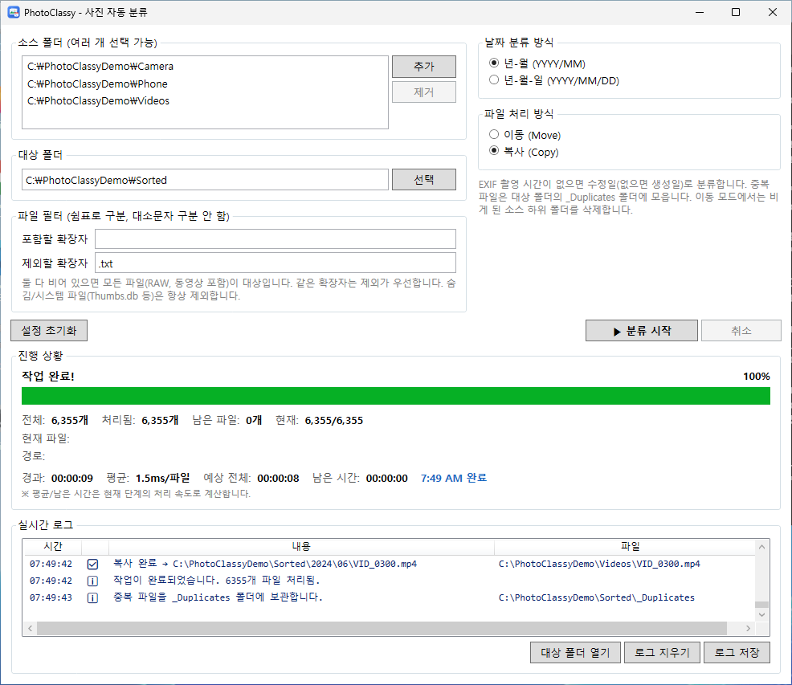
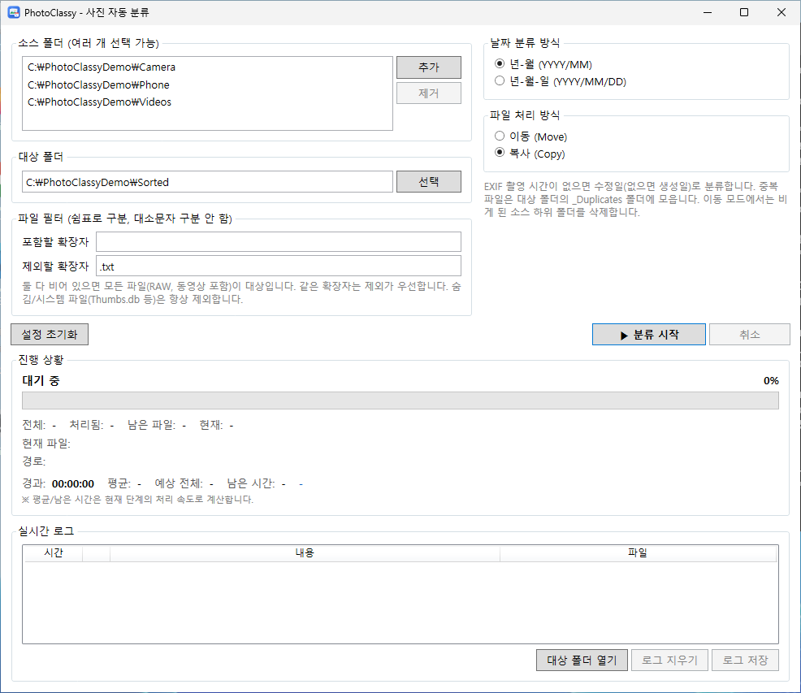
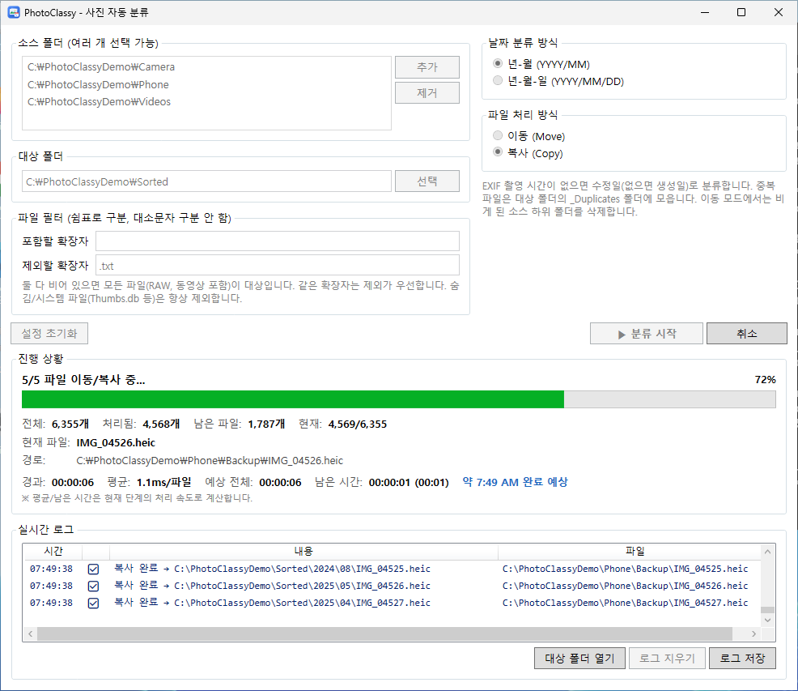
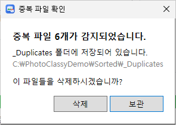
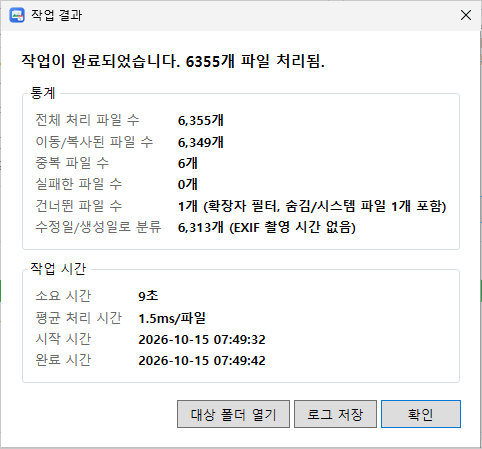
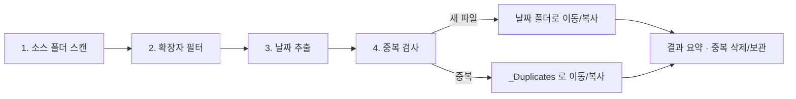

<div align="center">


# PhotoClassy

**흩어진 사진을 촬영 날짜별 폴더로 한 번에 정리하는 Windows 데스크톱 앱**

[](https://github.com/resious71/PhotoClassy/actions/workflows/build.yml)
[](https://github.com/resious71/PhotoClassy/releases/latest)
[](LICENSE)


[다운로드](https://github.com/resious71/PhotoClassy/releases/latest) ·
[사용 방법](#-사용-방법) ·
[동작 방식](#-동작-방식) ·
[빌드](#-소스에서-빌드) ·
[변경 이력](CHANGELOG.md)



</div>

---

카메라, 휴대폰 백업, 메신저 다운로드 폴더에 흩어진 사진과 동영상을 **EXIF 촬영 날짜** 기준으로
`2026/01`, `2026/01/15` 같은 폴더에 자동으로 옮기거나 복사합니다.
같은 내용의 파일은 **SHA256 해시로 찾아 따로 모아 주므로**, 같은 사진이 여러 번 쌓이지 않습니다.

## ✨ 주요 기능

| | |
|---|---|
| 📅 **날짜별 자동 분류** | EXIF `DateTimeOriginal` → `DateTime` → 수정일 → 생성일 순서로 날짜를 정해 `YYYY/MM` 또는 `YYYY/MM/DD` 폴더에 정리 |
| 📂 **여러 소스 폴더** | 여러 폴더를 한 번에 추가하고, 하위 폴더까지 모두 처리 |
| 🔁 **이동 / 복사** | 다른 드라이브로 이동할 때는 복사 → 크기·SHA256 검증 → 검증에 성공해야만 원본 삭제 |
| 🧬 **중복 파일 감지** | 파일명이 달라도 내용이 같으면 중복. 이미 정리된 대상 폴더의 파일과도 비교해 재실행에도 안전 |
| 🎞️ **RAW·동영상 지원** | CR2, NEF, ARW, MOV, MP4 등도 기본 대상 (EXIF 가 없으면 수정일로 분류) |
| 🔎 **확장자 필터** | 포함/제외 확장자 지정 (겹치면 제외 우선). Thumbs.db 같은 숨김/시스템 파일은 항상 제외 |
| ⏱️ **진행 상황** | 단계별 진행률, 경과·평균·남은 시간, 예상 완료 시각, 실시간 로그 |
| 🛡️ **안전장치** | 시작 전 폴더 겹침·여유 공간 검사, 같은 파일명은 `_1`, `_2` 로 이름 변경, 권한 오류 시 관리자 권한 재실행 제안 |
| 🧹 **정리** | 이동 후 비게 된 소스 하위 폴더 자동 삭제 |
| 💾 **설정 저장** | 마지막 설정을 `config.json` 에 저장해 다음 실행 때 복원 |

## 📸 스크린샷

<table>
  <tr>
    <td width="50%"><br /><sub><b>설정</b> — 소스/대상 폴더, 분류 방식, 확장자 필터</sub></td>
    <td width="50%"><br /><sub><b>진행</b> — 단계, 진행률, 남은 시간, 실시간 로그</sub></td>
  </tr>
  <tr>
    <td><br /><sub><b>중복 파일 확인</b> — _Duplicates 폴더 삭제 또는 보관</sub></td>
    <td><br /><sub><b>작업 결과</b> — 처리 통계와 작업 시간</sub></td>
  </tr>
</table>

> 스크린샷은 [GitHub Actions](.github/workflows/screenshots.yml) 의 Windows 러너에서 샘플 데이터로 실제 앱을 실행해 캡처한 화면입니다.

## 📥 설치

[최신 릴리스](https://github.com/resious71/PhotoClassy/releases/latest)에서 내려받으세요.

| 파일 | 설명 |
|------|------|
| `PhotoClassySetup-vX.Y.Z.exe` | **권장.** .NET Framework 4.7.2 가 없으면 함께 설치합니다. |
| `PhotoClassy-vX.Y.Z.msi` | .NET Framework 4.7.2 이상이 이미 있는 PC 용 (Windows 10 1803 이상은 기본 포함) |
| `PhotoClassy-vX.Y.Z-portable.zip` | 설치 없이 압축을 풀어 `PhotoClassy.exe` 실행 |

**요구 사항:** Windows 10 / 11, .NET Framework 4.7.2 이상

> 코드 서명이 되어 있지 않아 처음 실행할 때 Windows SmartScreen 경고가 나올 수 있습니다. **추가 정보 → 실행**을 누르세요.

제거는 **설정 → 앱** 또는 시작 메뉴의 **PhotoClassy 제거**에서 할 수 있습니다.

## 🚀 사용 방법

1. **소스 폴더**에서 `추가`를 눌러 정리할 사진 폴더를 하나 이상 추가합니다.
2. **대상 폴더**를 선택합니다. (없으면 시작할 때 만들지 묻습니다)
3. **날짜 분류 방식**(년-월 / 년-월-일)과 **파일 처리 방식**(이동 / 복사)을 고릅니다.
4. 필요하면 **포함할 확장자**나 **제외할 확장자**를 쉼표로 입력합니다. 예: `.jpg, .png, .cr2`
5. `▶ 분류 시작`을 누릅니다.
6. 중복 파일이 있으면 `_Duplicates` 폴더를 **삭제**할지 **보관**할지 고릅니다.
7. 결과 화면에서 `대상 폴더 열기`, `로그 저장`을 할 수 있습니다.

> ⚠️ **이동** 모드는 원본 파일을 옮깁니다. 처음 사용할 때는 **복사** 모드로 결과를 확인해 보세요.

### 결과 폴더 구조

```
대상폴더/
├── 2025/
│   ├── 07/
│   │   ├── IMG_1004.jpg
│   │   └── VID_0012.mp4
│   └── 12/
├── 2026/
│   └── 01/
│       ├── IMG_1001.jpg
│       └── IMG_1001_1.jpg      ← 같은 이름의 다른 사진은 _1, _2 …
└── _Duplicates/                ← 내용이 같은 중복 파일 (같은 날짜 구조)
    └── 2026/
        └── 01/
            └── KakaoTalk_Photo_01.jpg
```

`년-월-일` 방식은 `2026/01/15/` 처럼 일 폴더가 한 단계 더 생깁니다.

## ⚙️ 동작 방식



| 단계 | 내용 |
|------|------|
| **스캔** | 소스 폴더를 하위까지 탐색합니다. 대상 폴더와 바로 가기(정션) 폴더는 건너뜁니다. |
| **필터** | 포함/제외 확장자를 적용합니다. 둘 다 비어 있으면 모든 파일이 대상이고, 숨김/시스템 파일은 항상 제외합니다. |
| **날짜** | EXIF `DateTimeOriginal` → `DateTime` → 파일 수정일 → 생성일. EXIF 에 기록된 시각을 그대로 쓰며 시간대 보정은 하지 않습니다. 대체 날짜를 쓰면 로그에 ⚠️ 로 표시합니다. |
| **중복** | 크기가 같은 파일만 SHA256 을 계산합니다. 이번 소스 파일끼리, 그리고 대상 폴더에 이미 있는 파일과 비교합니다. |
| **이동/복사** | 같은 드라이브 이동은 파일 시스템 이동, 다른 드라이브는 복사 후 검증을 거쳐 원본을 삭제합니다. 검증에 실패하면 원본을 그대로 둡니다. |

개별 파일 오류는 로그에 기록하고 계속 진행하며, 디스크가 가득 차거나 대상 폴더에 접근할 수 없게 되면 작업을 멈춥니다.

### 설정 파일 (`config.json`)

설치 폴더에 저장되며, 앱을 다시 실행하면 자동으로 불러옵니다. `설정 초기화` 버튼으로 기본값으로 되돌릴 수 있습니다.

```json
{
  "sourceFolders": ["C:\\Users\\User\\Pictures", "C:\\Users\\User\\Downloads"],
  "targetFolder": "D:\\ClassifiedPhotos",
  "classificationFormat": "YYYY/MM",
  "fileOperation": "Move",
  "includingExtensions": [],
  "BarringExtensions": []
}
```

## 🛠️ 소스에서 빌드

**필요:** Windows, [.NET SDK 8](https://dotnet.microsoft.com/download) (또는 Visual Studio 2022)

```powershell
git clone https://github.com/resious71/PhotoClassy.git
cd PhotoClassy

dotnet test  tests/PhotoClassy.Core.Tests -c Release      # 단위 테스트
dotnet build src/PhotoClassy -c Release                    # 앱 → src/PhotoClassy/bin/Release/net472
dotnet build installer/PhotoClassy.Bundle -c Release       # MSI + 설치 프로그램
```

Visual Studio 에서는 `PhotoClassy.sln` 을 엽니다. 설치 프로젝트(`.wixproj`)는 WiX Toolset v5 SDK 를 NuGet 으로 받으며,
Visual Studio 에서 열려면 [HeatWave](https://marketplace.visualstudio.com/items?itemName=FireGiant.FireGiantHeatWaveDev17) 확장이 필요합니다.

분류 엔진(`PhotoClassy.Core`)은 UI 와 분리되어 있어 Linux/macOS 에서도 테스트를 실행할 수 있습니다.

### 프로젝트 구조

```
PhotoClassy/
├── src/
│   ├── PhotoClassy.Core/        # 분류 엔진 (net472 + 테스트용 net8.0)
│   │   ├── Engine/              #   전체 처리 흐름, 결과
│   │   ├── Dates/               #   EXIF 날짜 추출
│   │   ├── Duplicates/          #   SHA256 중복 검사, _Duplicates 정리
│   │   ├── Operations/          #   이동/복사, 경로·이름 충돌 처리
│   │   ├── Filtering/ Scanning/ Validation/ Settings/ Progress/ IO/
│   └── PhotoClassy/             # WPF 앱 (MVVM)
├── tests/PhotoClassy.Core.Tests # xUnit 테스트
├── installer/
│   ├── PhotoClassy.Installer/   # WiX MSI
│   └── PhotoClassy.Bundle/      # .NET Framework 포함 설치 프로그램
├── tools/screenshots/           # README 스크린샷 자동 캡처
└── .github/workflows/           # build, screenshots, release
```

### 릴리스 만들기

`CHANGELOG.md` 에 새 버전을 적고, 버전을 올린 뒤 태그를 푸시하면
[release 워크플로](.github/workflows/release.yml)가 설치 파일을 만들어 GitHub Release 에 올립니다.

```bash
git tag v1.0.0
git push origin v1.0.0
```

버전은 `src/PhotoClassy/PhotoClassy.csproj`, `installer/PhotoClassy.Installer/Package.wxs`, `installer/PhotoClassy.Bundle/Bundle.wxs` 에 있습니다.

## 🤝 기여하기

버그 신고와 제안은 [Issues](https://github.com/resious71/PhotoClassy/issues) 에, 코드 기여는 Pull Request 로 보내 주세요.
PR 을 보내기 전에 `dotnet test tests/PhotoClassy.Core.Tests` 가 통과하는지 확인해 주세요.

## 🙏 사용한 오픈소스

- [MetadataExtractor](https://github.com/drewnoakes/metadata-extractor-dotnet) — EXIF 메타데이터 읽기 (Apache-2.0)
- [Newtonsoft.Json](https://www.newtonsoft.com/json) — 설정 파일 (MIT)
- [WiX Toolset](https://wixtoolset.org/) — 설치 파일 (MS-RL)

## 📄 라이선스

[MIT](LICENSE) © 2026 resious71
